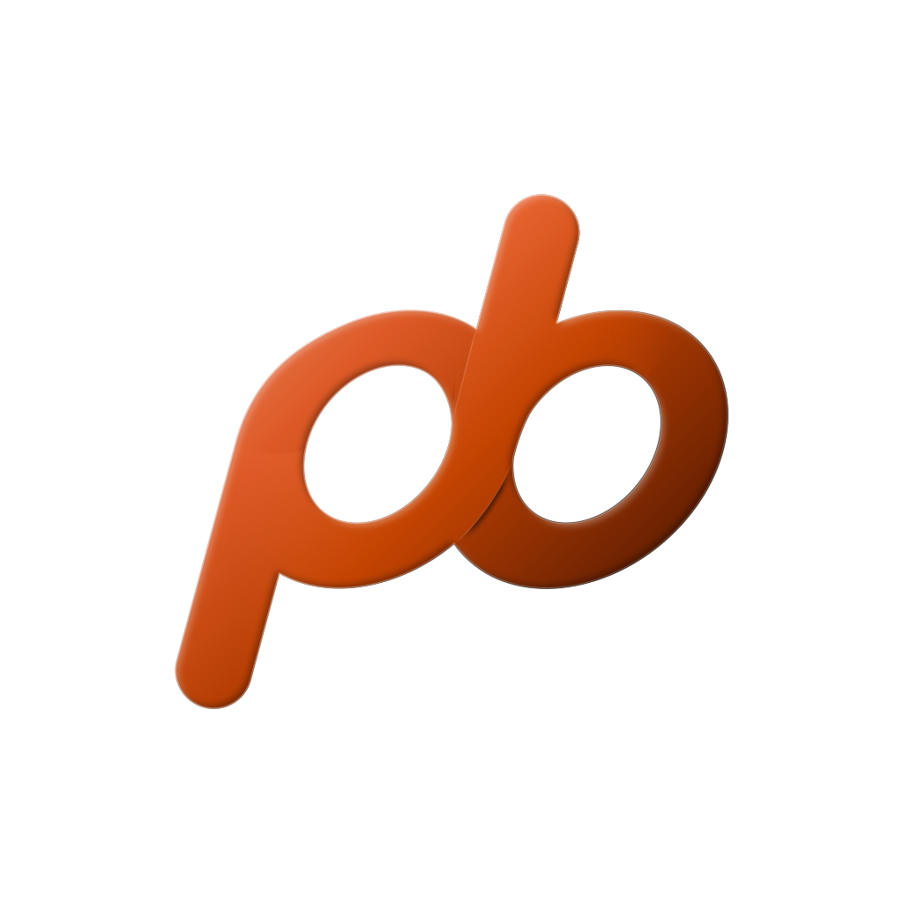

  

# Postbeep

Postbeep is a personal iPhone build of [bb](https://github.com/get-bb/bb). It installs beside the App Store bb app, connects to a stock bb server, and keeps a page's audio playing while the phone is locked or another app is in front, so that Talkback can be heard that way.

This repository is a fork of [get-bb/bb](https://github.com/get-bb/bb). [fork/README.md](../fork/README.md) lists what the fork changes and how to build and update it. bb's own README is [README.md](../README.md).

Nothing here is sent upstream.
